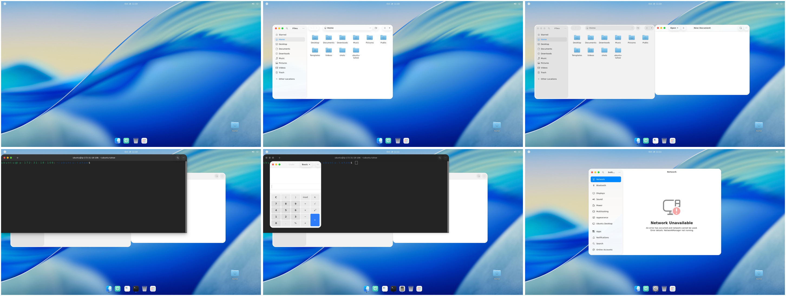
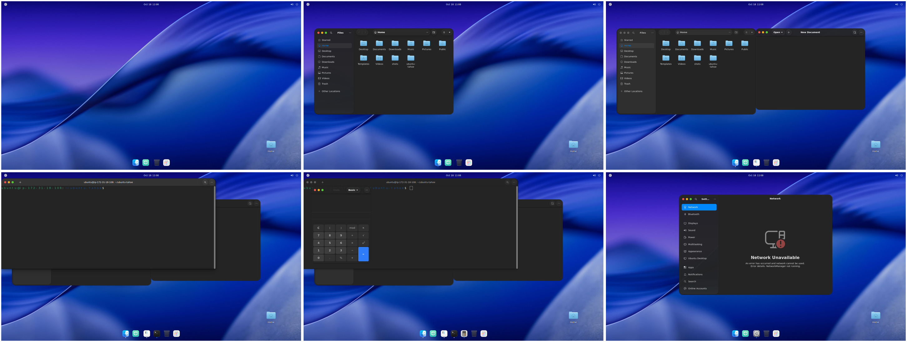

# Ubuntu Tahoe

Give your **Ubuntu 24.04** desktop the look of **macOS Tahoe**, in light and dark mode, and remove it again with one command.




> **Tested on Ubuntu 24.04.5 LTS with GNOME Shell 46.0** (Xorg and Wayland), on 2026-10-18: 38 offline tests, 42 robustness tests on a real desktop (run twice), a Wayland check, a reboot, lock/unlock, a fresh-PC package install, a reset of a heavily customised desktop, and full uninstall. All passed. See [docs/acceptance.md](docs/acceptance.md).

## Install (2 steps)

**1. Download it.** Open a Terminal (`Ctrl`+`Alt`+`T`) and run:

```bash
git clone <your-repository-url> ~/ubuntu-tahoe && cd ~/ubuntu-tahoe
```

(No `git`? Run `sudo apt install git` first, or download the ZIP from the repository page and unzip it into your home folder.)

**2. Install it.**

```bash
./install.sh
```

If a few Ubuntu packages are missing, it asks **"Install them now with sudo apt? [Y/n]"**. Press `Enter` and type your password. That's the only time it ever uses `sudo`.

**Then log out and log back in once.** That's it.

> Want to see what it would do first? `./install.sh --dry-run` changes nothing.

### Already customised your desktop? Start from Ubuntu defaults

If you've installed other themes, GNOME extensions (another dock, Dash to Panel, another blur), or custom GTK CSS, start from a clean Ubuntu look so nothing conflicts:

```bash
./install.sh --reset
```

This first **saves a backup of your current look**, resets the appearance to Ubuntu's defaults, and then installs Tahoe. It resets the theme, icons, cursor, light/dark style, wallpaper, window buttons, dock settings, which extensions are enabled, and custom GTK CSS (moved into the backup, not deleted). It does **not** touch fonts, text size, accessibility, keyboard, mouse, displays, apps or files.

Changed your mind later? Remove Tahoe and get your old look back exactly:

```bash
./uninstall.sh --all
./scripts/reset-appearance.sh --restore
```

(`./install.sh --reset --dry-run` shows what would be reset without changing anything. To reset without installing Tahoe: `./scripts/reset-appearance.sh`.)

### What gets installed from Ubuntu

On a fresh Ubuntu 24.04 desktop, the installer will ask to add these four packages from Ubuntu's own repositories: `sassc`, `libglib2.0-dev-bin`, `gnome-shell-extensions`, `curl`. Everything else is already part of Ubuntu. `./install.sh --yes` installs them without asking.

## Light mode and dark mode

Ubuntu Tahoe follows Ubuntu's own light/dark setting. Everything switches together: windows, top bar, icons, dock, wallpaper (day ↔ night), and apps.

Pick whichever is easiest:

- **Quick menu:** click the top-right corner of the screen, then click **Dark Style**. Off = light, on = dark.
- **Settings:** open **Settings → Appearance** and choose **Light** or **Dark**.
- **Terminal:**
  ```bash
  ~/ubuntu-tahoe/scripts/style.sh light    # light mode
  ~/ubuntu-tahoe/scripts/style.sh dark     # dark mode
  ~/ubuntu-tahoe/scripts/style.sh toggle   # switch
  ```

Apps that are already open switch the next time you open them.

## What it changes

| Part | What you see |
|---|---|
| Theme | macOS-style windows, menus and dialogs ([MacTahoe](https://github.com/vinceliuice/MacTahoe-gtk-theme)), light and dark |
| Window buttons | Red/yellow/green buttons on the left |
| Icons and cursor | MacTahoe icons and pointer |
| Wallpaper | Tahoe day wallpaper (light), night wallpaper (dark) |
| Dock | Ubuntu's dock becomes a centred, floating dock at the bottom |
| Blur | Frosted dock and overview ([Blur My Shell](https://github.com/aunetx/blur-my-shell)) |

Want only part of it?

```bash
./install.sh --profile minimal     # only the theme (windows, top bar, menus)
./install.sh --module dock         # only one part: appearance, icons, cursor, wallpaper, dock, blur
```

## Uninstall

```bash
cd ~/ubuntu-tahoe && ./uninstall.sh --all
```

Then log out and back in. Your desktop is back exactly as it was: every file it added is removed and every setting goes back to its original value. If you changed a setting yourself after installing (for example, moved the dock), your choice is kept. To remove just one part: `./uninstall.sh --module dock`.

## Is it safe for my computer?

Yes. It was designed and tested for that:

- **Only your user account is changed.** No system files and no login screen changes. Tests confirm nothing outside your home folder is touched.
- **Everything is reversible.** Original values are recorded before anything changes (`~/.local/state/ubuntu-tahoe/`).
- **Your own files are kept.** If you already have your own `~/.config/gtk-4.0` styling, it is set aside and put back on uninstall.
- **Failures clean up after themselves.** If the internet drops or the install is interrupted, it rolls back, and you can simply run it again.
- **Verified downloads only.** Exact pinned versions, checked by SHA-256; corrupted downloads are fetched again.
- **Clean start available.** `./install.sh --reset` brings a customised desktop back to Ubuntu defaults first, with a backup you can restore.
- **No forced extensions.** Extensions are installed only if they officially support your GNOME version.

If something ever looks wrong, see [docs/recovery.md](docs/recovery.md).

## Good to know

- **Ubuntu Terminal** keeps its own dark colours in light mode. Change this in Terminal → Preferences → Profiles if you like.
- **Firefox and other Snap/Flatpak apps** keep their own look.
- **Accent colour:** Tahoe blue is used. Ubuntu's accent colour picker has no effect while Tahoe is installed (it switches back to Tahoe automatically).
- **Font:** Apple's San Francisco font is proprietary and not included.

## For developers

```bash
./tests/run.sh    # 38 offline tests (fake GNOME settings; never touches your desktop)
```

End-to-end testing runs on a disposable AWS desktop: [infra/aws/terraform/README.md](infra/aws/terraform/README.md). Design notes: [docs/architecture.md](docs/architecture.md). Third-party components and licenses: [THIRD_PARTY_NOTICES.md](THIRD_PARTY_NOTICES.md), [docs/component-audit.md](docs/component-audit.md).

The repository's scripts are MIT-licensed. Third-party components keep their own licenses.
